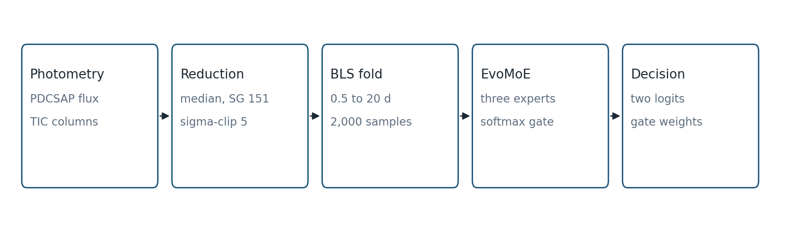
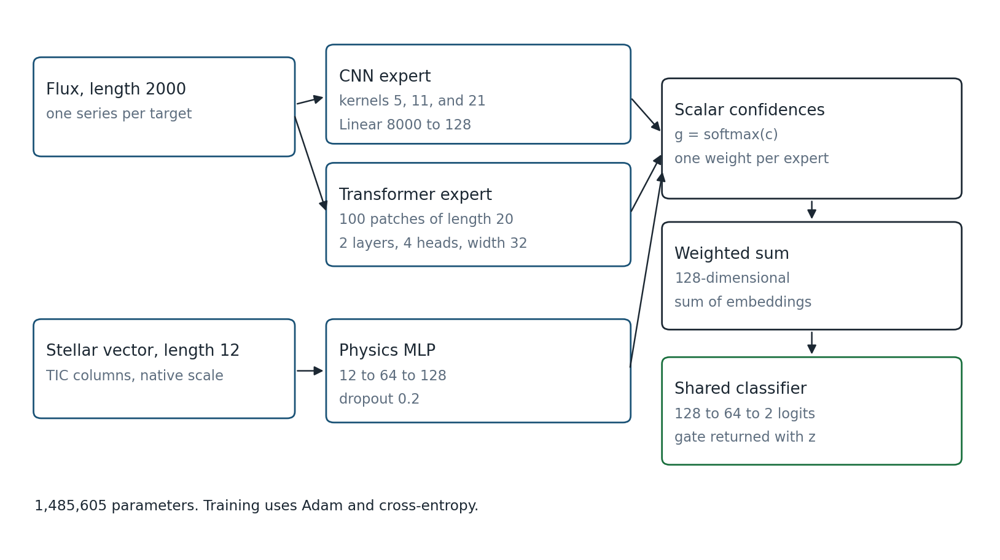
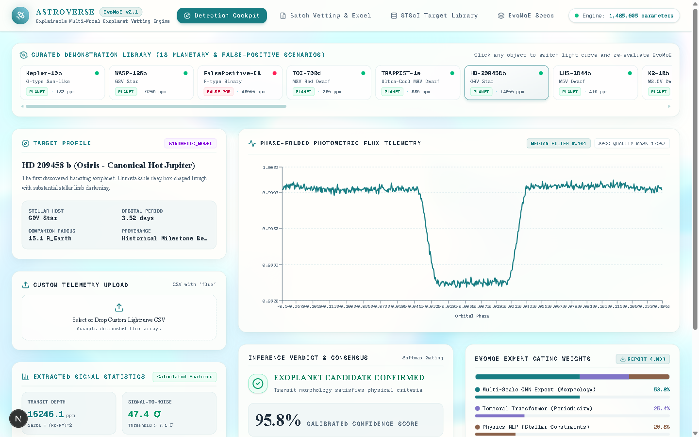
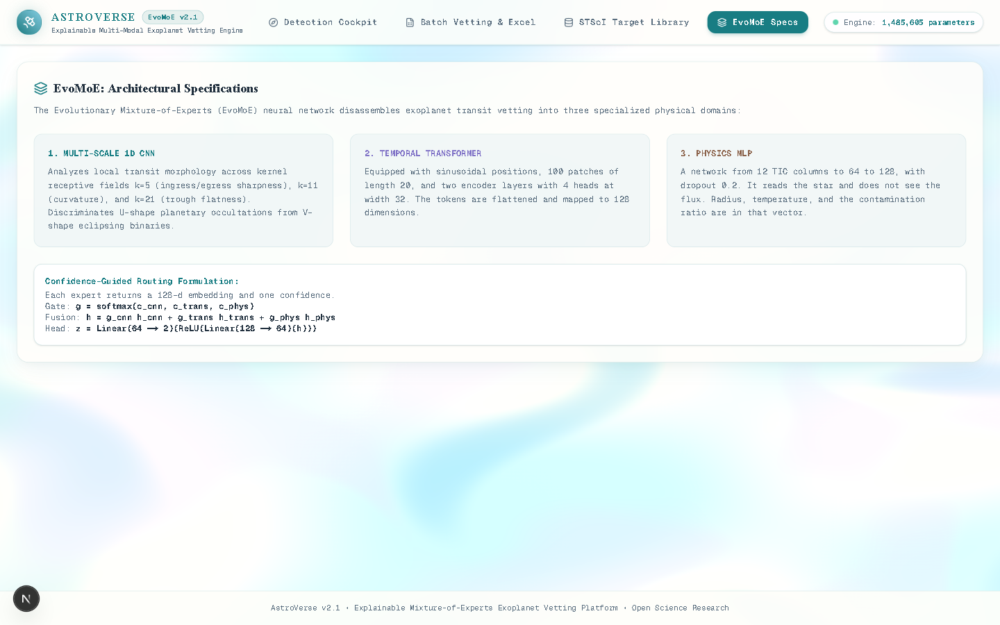

# AstroVerse

AstroVerse is an open stack for photometric transit vetting. A light curve goes in. Three experts look at it: one at the shape of the dip, one at the folded sequence, one at the star. A softmax over their confidences is returned with the score, so the reason for the decision is part of the forward pass.

Mahaveer Singh Gehlot, Shruti Srivastava, and Taher Babat. Department of Computer Engineering and Technology, MIT World Peace University, Pune.

[](https://github.com/mahik504/AstroVerse/actions/workflows/ci.yml)
[](https://opensource.org/licenses/MIT)

The network is EvoMoE. It has 1,485,605 parameters. On the CPU used for the manuscript, one target takes a median of 7.64 ms. Catalog-scale precision and recall are the measurement that follows this release. They are not in it.

## How a target moves



PDCSAP flux is divided by its median, detrended with a Savitzky–Golay window of 151, and sigma-clipped at 5σ. Box least squares searches periods from 0.5 to 20 days. The fold is resampled to 2,000 points and paired with twelve columns from the TESS Input Catalog.

## EvoMoE



Each expert returns a 128-dimensional embedding and one confidence. The gate is the softmax of those three numbers. The embeddings are added with those weights, and a shared head maps the sum to two logits. The convolutional expert uses kernels of 5, 11, and 21. The transformer cuts the series into 100 patches of length 20. The physics network reads the star and never sees the flux.

The specification is [docs/ARCHITECTURE.md](docs/ARCHITECTURE.md). The module is `research/evonex/src/model_evonex.py`.

## AstroLens

AstroLens is the inspection client. It browses the eighteen-series reference library and plots the stored flux. The service behind it is FastAPI. `POST /predict` is the route that runs the network.



HD 209458 b from the reference library. The dip in that file measures 15,246 ppm, peak to median.



## Reference library

`demo/` holds the eighteen series used in the manuscript: rocky dips, hot-Jupiter U-shapes, a contact binary, a graze, a flare, a blend, a giant host, and two threshold cases. Three are archive-style. Fifteen are synthetic, each built around one morphology. Depths and signal-to-noise ratios are Table 3 of the paper, recomputed from the files.

## Run it

```bash
git clone https://github.com/mahik504/AstroVerse.git
cd AstroVerse

# API
cd services/evonex-api
pip install -r requirements.txt
python -m uvicorn main:app --port 8000

# client, second terminal
cd apps/astrolens-web
npm install
npm run dev
```

Open `http://localhost:3000`. Research tests:

```bash
cd research/evonex
pip install -r requirements.txt
python -m pytest tests/ -v
```

## Repository

```text
apps/astrolens-web/     AstroLens, Next.js
services/evonex-api/    FastAPI
research/evonex/        EvoMoE, reduction, BLS, tests
demo/                   18 reference light curves
paper/scie/             manuscript and figures
docs/                   architecture, model card, dataset card
```

| Doc | What it is |
| --- | --- |
| [Architecture](docs/ARCHITECTURE.md) | The forward pass, with the parameter split |
| [API](docs/API.md) | Service routes |
| [Model card](docs/Model_Card.md) | Intended use and the latency measurement |
| [Dataset card](docs/Dataset_Card.md) | The library, the six-target cache, the reduction |
| [Overview](docs/PROJECT_OVERVIEW.md) | Where to start in the code |
| [Reproducibility](docs/REPRODUCIBILITY.md) | How a run is specified |
| [Scope](docs/LIMITATIONS.md) | What this release does not score |
| [Manuscript](paper/scie/AstroVerse_SCIE_manuscript.pdf) | The 21-page writeup |

## Citation

```bibtex
@software{AstroVerse2026,
  author = {Gehlot, Mahaveer Singh and Srivastava, Shruti and Babat, Taher},
  title = {AstroVerse: a mixture-of-experts architecture for photometric transit vetting},
  year = {2026},
  url = {https://github.com/mahik504/AstroVerse}
}
```
